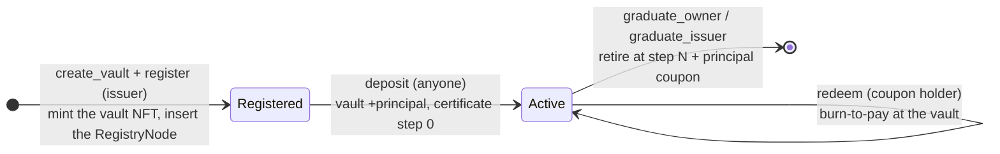

# Event-Triggered Assets — Usage Guide

How to deploy and operate the **tokenized bond**, a CIP-113 programmable
token whose units are **certificates**. A certificate's asset name is one
byte carrying its current **step** (`0` at deposit, `N` at maturity) and its
inline datum carries `{ start, commit, cnt_policy }`. Deposits are
**permissionless**: each moves one unit's principal into a chosen **vault**
and mints a step-`0` certificate. Over the bond's life a certificate claims
scheduled **coupon** tokens (`cNt` — plain native assets whose asset name is
the decimal lovelace amount they are worth) and redeems them at its vault
(**burn-to-pay**); at maturity it claims a principal-only coupon and is
retired. Every advance or retirement carries its coupon.

The instrument ships three withdraw-zero validators — `issuance` (minting
logic and registration authority), `transfer` (name-monotone) and
`third_party` (the opt-in issuer trigger) — plus a `vault` spending validator,
a per-vault `coupon_policy` and the `vault_nft_policy` (see the on-chain
listing below). All are exercised **by the CIP-113 core infrastructure**: the
Programmable Logic Base custodies every certificate UTxO and dispatches spends
to the transfer / third-party logic, and the parameterized `issuance_mint`
policy invokes the minting logic on every mint/burn. There is deliberately no
spend or mint endpoint of our own.

> **Source of truth.** Behavior, threat model, and invariants are specified in
> [`spec.md`](spec.md).
> This guide only covers day-to-day usage.

| Part | Where |
| --- | --- |
| On-chain validators | [`onchain/validators/event_triggered_assets.ak`](../../onchain/validators/event_triggered_assets.ak) (+ predicates in [`onchain/lib/event_triggered/`](../../onchain/lib/event_triggered/)) |
| MeshJS builders | [`offchain/meshjs/lib/src/event_triggered/`](../../offchain/meshjs/lib/src/event_triggered/) |
| Tx3 protocol + client | [`offchain/tx3/event-triggered-assets/`](../../offchain/tx3/event-triggered-assets/) |
| Compiled blueprint | [`onchain/plutus.json`](../../onchain/plutus.json) |

## Contents

- [Lifecycle](#lifecycle)
- [Roles](#roles)
- [Prerequisite: the CIP-113 core](#prerequisite-the-cip-113-core)
- [Deploying an instrument](#deploying-an-instrument)
- [Create the vault](#create-the-vault)
- [Register the instrument](#register-the-instrument)
- [Deposit (permissionless)](#deposit-permissionless)
- [Transfer and authorize](#transfer-and-authorize)
- [Coupon claims](#coupon-claims)
- [Redemption (burn-to-pay)](#redemption-burn-to-pay)
- [Graduation](#graduation)
- [Off-chain usage: Tx3 client](#off-chain-usage-tx3-client)
- [Gotchas and safety notes](#gotchas-and-safety-notes)
- [Where to go next](#where-to-go-next)

## Lifecycle



The coupon terms (`interval`, `amounts`) are **baked into each vault's coupon
policy**; the certificate's `cnt_policy` datum selects them. Times:

- **deposit** — `start` is pinned to the transaction's finite validity upper
  bound (I6); it is the certificate's timeline origin.
- **claim** — step `k` (1-indexed) opens at `start + k * interval`; the
  certificate advances `k-1 → k` and its coupon (`amounts[k-1]`) is minted.
- **graduation** — at maturity, `start + N * interval` where
  `N = length(amounts)`; the retired certificate claims the principal coupon.
  Afterwards the window stays open with **no upper bound** (graduation is
  opt-in, never forced).
- **transfer** and **authorize** read no time bound.

## Roles

| Role | Who | Powers |
| --- | --- | --- |
| **Issuer** | The registration authority baked into the minting logic | Signs registration and vault creation; triggers claims/graduation on committed certificates |
| **Owner** | The certificate UTxO's inline stake credential | Transfers freely, commits/revokes a payout credential, claims coupons, graduates, redeems |
| **Depositor** | Anyone | Runs the permissionless unit deposit (fees only) |
| **Coupon holder** | Whoever holds the `cNt` UTxO | Redeems coupons at the vault (burn-to-pay) |
| **Authority** | The vault NFT policy's `authority` (defaults to the issuer) | Mints one vault NFT per vault (creation is out of scope) |

Authorization: the issuer is a pluggable `Credential` (key = required signer,
script = withdraw-0). The issuer-triggered paths are **opt-in**: they work
only for certificates whose datum commits a payment credential
(`commit: Some(pay)`), and the coupon minted is bound to `pay` — the issuer can
trigger but never redirect (I9).

## Prerequisite: the CIP-113 core

Unlike the settings/DAO protocols, this instrument runs **inside** the
CIP-113 programmable-token framework (see
[`documentation/09-DEVELOPING-MODULES.md`](../../../cip113-programmable-tokens/documentation/09-DEVELOPING-MODULES.md)).
Before any instrument transaction, the core must be deployed:

1. **Parameterize the core scripts** in dependency order — the one-shot
   `OutputReference` seeds and the sibling script hashes chain into each
   other (the e2e harness
   [`offchain/meshjs/e2e/src/cip113/scripts.ts`](../../offchain/meshjs/e2e/src/cip113/scripts.ts)
   is the reference).
2. **Genesis transactions** — registry origin node, `IssuanceCborHex`
   template, upgrade-multisig config, protocol params
   ([`offchain/meshjs/e2e/src/cip113/deploy.ts`](../../offchain/meshjs/e2e/src/cip113/deploy.ts)
   is the reference; the Tx3 protocol carries the same four as
   `core_init_registry` / `core_init_cbor_hex` /
   `core_init_upgrade_config` / `core_init_protocol_params`).
3. **Register every withdraw-0 stake credential** — Conway evaluates the
   `publish` script purpose for script-credential registrations, so each
   module's own script must ride along as the certificate witness. The bond
   has exactly three: `issuance`, `transfer`, `third_party` (the vault spend
   validator and the two mint policies carry no stake credential).
4. **Apply the bond's parameters** — `applyBond` resolves the dependency
   order: transfer / third-party logic and vault NFT policy → vault → minting
   logic → `issuance_mint` (the governed policy) → coupon policy.

> **Dependency order.** The governed policy id is a hash *of* the
> `issuance_mint` script applied to the minting-logic credential, so no
> instrument validator may bake it — the module validators resolve it at
> runtime from the registry node. Only the coupon policy (outside that cone)
> bakes `cipPolicy`; the vault NFT policy is independent.

## Deploying an instrument

```ts
import { applyBond, type BondConfig } from "@contracts-library/meshjs";

const bond = applyBond(deployment, {
  principal: 1000,                         // unit principal, in lovelace
  interval: 10_000,                        // POSIX-ms between steps
  amounts: [1040],                         // per-step coupons; length = final step N
  issuer: { kind: "key", hash: issuerKeyHash },
  vaultNftName: "5630",                    // each vault's NFT name, hex
} satisfies BondConfig);

bond.cipPolicy;       // governed policy id (the certificate policy)
bond.cntPolicy;       // this bond's coupon policy id
bond.vaultHash;       // vault spending validator hash (the vault address)
bond.vaultNftCs;      // vault NFT policy id
bond.withdrawCredentials; // [issuance, transfer, thirdParty] — register these
```

`deployment` is the deployed core (`CoreDeployment`: the applied core scripts,
the reference UTxOs, and the raw `issuance_mint` code). Deploy each module
script as a reference script (or inline witness) and register the three
withdraw-0 stake credentials; the instrument is live.

## Create the vault

Vault creation is **out of scope** for the on-chain validators (I10, §7): the
only check is the vault NFT policy — the deployment's authority mints exactly
one NFT per vault. The vault UTxO carries its `VaultDatum` (binding the
coupon policy) and starts funded with the coupon reserve:

```ts
import { buildCreateVaultTx } from "@contracts-library/meshjs";

await buildCreateVaultTx({
  txBuilder,
  deployment, bond,
  vaultAda: 5_000_000n,        // coupon reserve + later deposits
  funding, collateral, changeAddress,
});
```

Whoever creates a vault must fund it and keep it funded; the vault is an
escrow — the owner can top it up at any time but cannot withdraw on-chain
(§7). Top up a vault's coupon reserve with `buildVaultTopUpTx`:

```ts
import { buildVaultTopUpTx } from "@contracts-library/meshjs";

await buildVaultTopUpTx({
  txBuilder,
  bond, vault,                  // the vault UTxO to top up
  amount: 2_000_000n,           // ADA added (any positive amount)
  funding, collateral, changeAddress,
});
```

Never send ADA to the vault address with a plain transfer: a UTxO without the
vault NFT and inline datum is not a vault and can never be spent.

## Register the instrument

One transaction inserts the bond's `RegistryNode` into the core registry and
pins its stance (name-monotone transfer logic, issuer-triggered third-party
logic, empty unfracking hook, empty global state). **No certificate is
minted** — the same registration serves every later deposit:

```ts
import { buildRegisterTx } from "@contracts-library/meshjs";

await buildRegisterTx({
  txBuilder,
  deployment, bond,
  covering: deployment.refs.originNode, // the first insert covers the origin node
  coveringNode: originNode,             // its datum (spent and re-emitted with
                                        // `next` = cipPolicy)
  funding, collateral, changeAddress,
});
```

The issuer signs. The registration is checked by the minting logic's
`Register` mode (§4.1).

## Deposit (permissionless)

Each deposit mints exactly one step-`0` certificate at the depositor's
PLB-custodied address, backed atomically by the chosen vault gaining exactly
the unit `principal` (I6). `start` must equal the transaction's finite
validity upper bound:

```ts
import { buildBondDepositTx } from "@contracts-library/meshjs";

const upperSlot = /* first slot at least ~30s ahead */;
const start = /* POSIX-ms start time of upperSlot */;

await buildBondDepositTx({
  txBuilder,
  deployment, bond,
  node,                          // the registered RegistryNode UTxO
  vault,                         // the chosen vault UTxO
  depositorStakeHash: holderKeyHash,
  start,                         // == the tx's validity upper bound
  validHereafterSlot: upperSlot, // the slot whose upper bound is `start`
  funding, collateral, changeAddress,
});
```

The certificate carries `commit: None` and the vault's `cnt_policy`; the
transaction needs no signature beyond the fee payer.

## Transfer and authorize

**Transfer** (§4.3) moves the certificate and with it that unit's right to
future coupons and the principal claim. The name is preserved; `commit` must
be cleared on an owner change. **Authorize** (§4.4) is a self-transfer that
writes (or clears) the payout commitment — only a self-transfer may change
`commit`:

| Builder | Purpose | Key args |
| --- | --- | --- |
| `buildTransferTx` | Plain transfer / owner change (§4.3) | `bond`, `node`, `certificate`, `recipientAddress`, `outputDatum`, `holderStakeHash` |
| `buildAuthorizeTx` | Opt-in/out of the issuer trigger (§4.4) | `bond`, `node`, `certificate`, `datum`, `commit` (`{ kind: "key", hash }` to commit, `null` to revoke) |

Both spend the certificate through the transfer dispatch chain and preserve
`start` and `cnt_policy` byte-for-byte.

## Coupon claims

Claiming the step-`k` coupon advances the certificate `k-1 → k` (same owner,
same datum, one unit) and mints `amounts[k-1]` under the certificate's
`cnt_policy`. The **issuer-triggered** path is permissionless on the holder
side but requires a committed certificate; the coupon is delivered to the
committed payment credential (I9):

```ts
import { buildClaimIssuerTx } from "@contracts-library/meshjs";

const step = 1;                       // 1-indexed: burns step 0, mints step 1
await buildClaimIssuerTx({
  txBuilder,
  deployment, bond,
  node,
  certificate,                        // the committed certificate UTxO
  step,
  datum,                              // the preserved certificate datum
  payoutAddress,                      // its payment credential must be the commit
  validFromSlot,                      // first slot reaching start + step * interval
  funding, collateral, changeAddress,
});
```

| Builder | Purpose | Key args |
| --- | --- | --- |
| `buildClaimOwnerTx` | Owner-signed claim (§4.5) | same as above + `couponAddress`, `holderStakeHash` (coupon delivered to the holder) |

Every advance **carries its coupon**: the minting logic's `Advance` mode
requires the coupon mint, and the coupon policy validates its amount and
deadline (I3).

## Redemption (burn-to-pay)

Coupons redeem at the vault for their face value: the coupons are burned and
the vault releases exactly the decoded sum (I4). Payouts are named in the
redeemer; payout outputs get at least the ledger min-ADA, and the excess over
the named amount comes from the payer's wallet — the vault's loss stays
exactly the burned value:

```ts
import { buildRedeemTx } from "@contracts-library/meshjs";

await buildRedeemTx({
  txBuilder,
  deployment, bond,
  vault: vaultUtxo,
  coupons: [couponUtxo /*, … one entry per coupon UTxO being burned */],
  payouts: [{ address: holderAddress, amount: 1040n }],
  funding, collateral, changeAddress,
});
```

Anyone can submit it; the coupon holder signs the spend. Redemption spends
exactly one vault and preserves its address, datum and NFT into exactly one
continuation (I10).

## Graduation

At maturity the certificate is retired: its final name is burned (no
continuation) and the principal coupon — named `encode(principal)` under the
certificate's `cnt_policy` — is minted (I5). The **issuer-triggered** path
requires the commitment and delivers the coupon to `pay`, leaving a
certificate-less **ghost shell** that preserves the spent UTxO's address and
datum byte-for-byte (the issuer can trigger but never redirect):

```ts
import { buildGraduateIssuerTx } from "@contracts-library/meshjs";

const final = bond.config.amounts.length;   // N, the maturity step
await buildGraduateIssuerTx({
  txBuilder,
  deployment, bond,
  node,
  certificate,                        // the committed certificate at step N
  step: final,
  datum,
  payoutAddress,                      // must be the commit
  validFromSlot,                      // first slot reaching start + N * interval
  funding, collateral, changeAddress,
});
```

| Builder | Purpose | Key args |
| --- | --- | --- |
| `buildGraduateOwnerTx` | Owner-signed retirement (§4.7) | `bond`, `node`, `certificate`, `step`, `couponAddress`, `holderStakeHash`, `validFromSlot` (no continuation) |

Finally, redeem the principal coupon at the vault with `buildRedeemTx` — the
vault pays the principal back and the unit is settled.

## Off-chain usage: Tx3 client

The Tx3 implementation lives in
[`offchain/tx3/event-triggered-assets/`](../../offchain/tx3/event-triggered-assets/)
with a generated client in `codegen/ts-client/tokenized-bond` (regenerate it
from [`main.tx3`](../../offchain/tx3/event-triggered-assets/main.tx3) with
`trix codegen`; do not edit by hand).

Install the runtime SDK in the directory that consumes the client:

```sh
npm install tx3-sdk
```

### Set up the client

```ts
import { Client } from "./codegen/ts-client/tokenized-bond/protocol";
import { Party } from "tx3-sdk";

const client = (signer: Party) =>
  new Client({ endpoint: "http://localhost:8164" }, "local")
    .withSigner(signer);       // issuer / depositor / holder / fee payer —
                               // the protocol's only declared party
```

Bind the protocol environment once per instrument — the applied script hashes
and their **single-CBOR** forms (the ledger's witness/reference content), the
reward-address bytes of every withdraw-0, and the reference UTxOs every
transaction carries:

```ts
const env = {
  // governed policy + minting witness
  cip_policy: bond.cipPolicy,
  cip_policy_script: unwrapCborBytes(bond.issuanceMint.code),
  // registry node-NFT policy + registry witness
  node_policy: registryNodeCs,
  node_policy_script: unwrapCborBytes(registry.code),
  // PLB base spend witness
  plb_script: unwrapCborBytes(programmableLogicBase.code),
  // vault (spend witness), coupon policy and vault NFT (mint witnesses)
  vault_script: unwrapCborBytes(bond.vault.code),
  coupon_policy: bond.cntPolicy,
  coupon_script: unwrapCborBytes(bond.couponPolicy.code),
  vault_nft_policy: bond.vaultNftCs,
  vault_nft_script: unwrapCborBytes(bond.vaultNft.code),
  vault_nft_name: "5630",
  vault_principal: 1000,
  // shared reference inputs
  protocol_params_ref: paramsUtxoRef,
  cbor_hex_ref: cborHexUtxoRef,
  // withdraw-0s: reference-script UTxO + CIP-19 reward-address BYTES (`f0`+hash)
  plb_global_script_ref, plb_global_script_address: `f0${plbGlobalHash}`,
  core_transfer_script_ref, core_transfer_script_address: `f0${coreTransferHash}`,
  core_third_party_script_ref, core_third_party_script_address: `f0${coreThirdPartyHash}`,
  core_issuance_script_ref, core_issuance_script_address: `f0${coreIssuanceHash}`,
  issuance_script_ref, issuance_script_address: `f0${issuanceHash}`,
  transfer_logic_script_ref, transfer_logic_script_address: `f0${transferHash}`,
  third_party_logic_script_ref, third_party_logic_script_address: `f0${thirdPartyHash}`,
  // minting-logic credential hash (RegistryInsert redeemer)
  issuance_hash: issuanceHash,
  // core bootstrap only (test kit; see the devnet test)
  cbor_hex_policy, cbor_hex_script,
  upgrade_multisig_policy, upgrade_multisig_script,
  upgrade_multisig_script_ref, upgrade_multisig_stake_address,
  params_policy, params_script,
};
```

Every `tx` exposes the four-stage lifecycle `resolve → sign → submit → wait`
(see the [Tx3 consuming guide](https://docs.txpipe.io/tx3/consuming/quick-start)).

### Key actions

```ts
// Create the vault: mint its NFT into a newly funded vault UTxO (issuer signs)
await client(issuer)
  .createVault({ vault_address: vaultAddr, vault_ada: 5_000_000 })
  .env(env).resolve().then((r) => r.sign()).then((s) => s.submit());

// Register: insert the RegistryNode (no certificate minted)
await client(issuer)
  .register({
    node_datum: registryNode,
    covering_ref: originNodeRef,         // spent and re-emitted with
                                         // `next` = `cip_policy`
    covering_address: registryAddr,
    covering_datum: coveringDatum,       // the covering node's continuation
  })
  .env(env).resolve().then((r) => r.sign()).then((s) => s.submit());

// Deposit: vault +principal, certificate step 0 (permissionless)
const untilSlot = tip.slot + 30;         // the tx's validity upper bound
await client(depositor)
  .deposit({
    vault_address: vaultAddr, vault_ref: vaultRef,
    vault_datum: { cnt_policy: bond.cntPolicy },
    certificate_address: plbAddr(holder),      // PLB payment + holder stake
    step_name: "00",                           // step 0 (one byte)
    start: slotTimeMs(untilSlot),              // must equal the upper bound
    until_slot: untilSlot,
    params_idx: paramsIdx, node_idx: nodeIdx, node_ref: nodeRef,
  })
  .env(env).resolve().then((r) => r.sign()).then((s) => s.submit());

// Vault top-up: anyone adds ADA to the vault (escrow funding, no withdrawal)
await client(owner)
  .vaultTopUp({
    vault_address: vaultAddr, vault_ref: vaultRef,
    vault_datum: { cnt_policy: bond.cntPolicy },
    top_up_amount: 2_000_000,
  })
  .env(env).resolve().then((r) => r.sign()).then((s) => s.submit());

// Issuer-triggered claim: step k-1 -> k, coupon to the committed payout
await client(issuer)
  .claimIssuer({
    certificate_address: plbAddr(holder), certificate_ref: certRef,
    old_name: "00", new_name: "01",
    coupon_name: couponName(1040),             // decimal bytes of 1040, hex
    pay_address: committedPayoutAddress,
    params_idx: paramsIdx, node_idx: nodeIdx, wdrl_idx: wdrlIdx,
    node_ref: nodeRef,
    since_slot: firstSlotAt(start + 10_000),   // step 1 opens at start + interval
  })
  .env(env).resolve().then((r) => r.sign()).then((s) => s.submit());

// Redeem: burn the coupon, the vault pays exactly its decoded value
await client(couponHolder)
  .redeem({
    coupon_ref: couponRef,
    coupon_name: couponName(1040),
    coupon_quantity: 1,
    vault_address: vaultAddr, vault_ref: vaultRef,
    vault_datum: { cnt_policy: bond.cntPolicy },
    payout_address: payoutAddress,
    payout_address_data: addressData(payoutAddress), // Aiken Address data form
    payout_amount: 1040,                       // declared == burned value
    payout_lovelace: 2_000_000,                // output ADA (>= payout_amount)
  })
  .env(env).resolve().then((r) => r.sign()).then((s) => s.submit());

// Issuer-triggered graduation: retire at step N + principal coupon to pay
await client(issuer)
  .graduateIssuer({
    certificate_address: plbAddr(holder), certificate_ref: certRef,
    final_name: "01",                          // step N
    principal_coupon_name: couponName(1000),
    pay_address: committedPayoutAddress,
    params_idx: paramsIdx, node_idx: nodeIdx, wdrl_idx: wdrlIdx,
    node_ref: nodeRef,
    since_slot: firstSlotAt(start + 10_000),   // maturity: start + N * interval
  })
  .env(env).resolve().then((r) => r.sign()).then((s) => s.submit());
```

| Action | Key args |
| --- | --- |
| `transfer` | `certificate_address`, `certificate_ref`, `recipient_address`, `certificate_datum`, `params_idx`, `node_idx`, `wdrl_idx`, `node_ref` |
| `authorize` | `certificate_address`, `certificate_ref`, `payout_credential` (`Some`/`None`), `params_idx`, `node_idx`, `wdrl_idx`, `node_ref` |
| `claimOwner` | `claimIssuer` args, but with `coupon_address` instead of `pay_address` (owner signs) |
| `graduateOwner` | `graduateIssuer` args, but with `coupon_address` instead of `pay_address` (owner signs, no shell) |

Notes:

- **`params_idx` / `node_idx` / `wdrl_idx` are ledger-ordered and volatile.**
  Reference inputs reach the validator sorted by `(txHash, outputIndex)` and
  every reference-script UTxO behind a `policy { ref: … }` counts as a
  reference input; adding another one or a withdrawal shifts every later
  index. Recompute them per transaction.
- **Paired outputs come first on the issuer path.** `claim_issuer` and
  `graduate_issuer` emit the certificate continuation / ghost shell as the
  first output (the core `third_party` redeemer's `outputs_start_idx` is 0);
  `redeem` emits the payout first and the vault continuation second. Prefer
  re-reading UTxOs by address when chaining transactions.
- **`payout_address_data` is the Aiken data form.** Tx3 serializes its
  `Address` primitive as raw address bytes, which a validator decoding an
  `Address` from data cannot read. The redeem redeemer carries
  `Constr 0 [PaymentCredential, Option<Referenced<Credential>>]`; the devnet
  test derives it from the bech32 address with a small helper.
- **Core bootstrap is test-kit only.** `coreInitRegistry`, `coreInitCborHex`,
  `coreInitUpgradeConfig`, `coreInitProtocolParams` exist to bootstrap a trix
  devnet; in production the core is deployed once by the framework operator.
- **Script bootstrap material.** `cip_policy_script`, `node_policy_script`,
  `plb_script`, `vault_script`, `coupon_script`, `params_script`, etc. carry
  the **single-CBOR** forms the ledger's mint/spend witness expects.

## Gotchas and safety notes

- **Ownership is the inline stake credential (I1).** The certificate address
  must carry the owner's stake credential inline (PLB payment + holder stake);
  a UTxO without one (or pointer-backed) fails closed on claims and
  retirement.
- **`start` is pinned to the deposit's validity upper bound (I6).** It must
  equal it exactly, and the bound must be finite: pick a slot in the future
  and use its start time as `start`.
- **Every advance carries its coupon (I3/I5).** No certificate can claim a
  step twice, skip its coupon, or be retired without the principal coupon;
  the coupon policy validates amounts and deadlines against the baked terms.
- **Burn-to-pay exactness (I4).** The redeemer names the payouts and their
  total must be exactly `Σ decode(name) × burned_quantity`; the vault loses
  exactly that. Payout outputs may carry the ledger min-ADA instead of the
  named amount — the excess is the payer's.
- **Committed trigger only (I9).** The issuer-triggered paths require
  `commit: Some(pay)`, and every output carrying the coupon must pay `pay`.
  `commit` is owner-set, may change only on a self-transfer, and is cleared on
  an owner change. The ghost shell preserves the spent UTxO's address and
  datum byte-for-byte.
- **Vault identity is the NFT (I10).** Every vault UTxO carries exactly one
  `vault_nft_cs` NFT; the deposit, top-up and redemption require it, so a fake
  output at the vault address can never back a certificate. Creation is out of
  scope; the vault is an escrow with no owner withdrawal path (§7), so fund it
  through `buildBondDepositTx`/`buildVaultTopUpTx` — ADA sent to the vault
  address without the NFT and inline datum is locked forever.
- **Names are raw bytes.** The certificate's name is its step, exactly one
  byte (`N ≤ 255`); a coupon's name is the decimal bytes of its lovelace value
  (leading zeros rejected on-chain). Tx3 string literals are UTF-8 —
  `"1040"` encodes as the coupon's actual bytes; passing hex text creates a
  different asset name.
- **Script framing is the single most common off-chain failure.** The ledger
  hashes the **content** directly (`blake2b224(0x03 || content)`, where
  `content` is the single-CBOR form) while `applyParamsToScript` returns the
  double-CBOR form — so `scriptHashOf(code) = resolveScriptHash(code)` equals
  the ledger hash of `unwrapCborBytes(code)`, and the registry's
  `apply_hashed_parameter` reconstructs the **single** form. Use
  `unwrapCborBytes` for witness/reference content and the library's
  `scriptHashOf` for hashes; mixing the conventions yields
  `minting lacks the required policy` or an extraneous redeemer.
- **Reward addresses are bytes.** The Tx3 `*_script_address` environment
  fields are CIP-19 reward-address **bytes** (`f0` + script hash), not bech32.
- **Script-credential stake registration needs publish consent.** Conway's
  ledger evaluates the `publish` script purpose for every script-credential
  `RegisterStake`: attach the module's own script as the certificate witness
  with a unit redeemer, or ogmios rejects the tx with `ExtraneousRedeemers`.

## Where to go next

- [Spec](spec.md) — full transaction tables (§4), invariants (§6), and the
  threat model (§7).
- [On-chain code](../../onchain/validators/event_triggered_assets.ak) — the
  three withdraw-zero validators, the vault spend validator and the two mint
  policies; composable predicates and tests in
  [`onchain/lib/event_triggered/`](../../onchain/lib/event_triggered/).
- [MeshJS e2e test](../../offchain/meshjs/e2e/test/event_triggered.e2e.test.ts) —
  the owner happy path over the real CIP-113 core against a Yaci devnet.
- [Tx3 devnet test](../../offchain/tx3/event-triggered-assets/tests/devnet.test.ts) —
  the full lifecycle with the generated client, owner and issuer-triggered
  paths, including the core bootstrap.
- [Architecture](../ARCHITECTURE.md) — composability conventions shared by
  every contract in the library.
