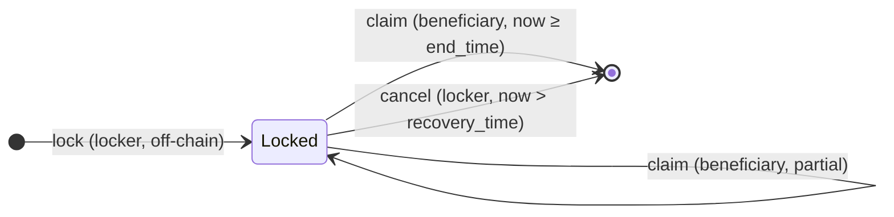

# Linear Vesting — Usage Guide

How to lock, claim, and cancel a **linear vesting** instance: a UTxO that
releases a bundle of assets to a single beneficiary between a start and end
time, with a locker recovery window after vesting completes.

> **Source of truth.** Behavior, invariants, and the threat model are specified
> in [`spec.md`](spec.md). This guide only covers day-to-day usage.

| Part | Where |
|---|---|
| On-chain validator | [`onchain/validators/linear_vesting.ak`](../../onchain/validators/linear_vesting.ak) (+ composable predicates in [`onchain/lib/vesting/`](../../onchain/lib/vesting/)) |
| MeshJS builders | [`offchain/meshjs/lib/src/vesting/`](../../offchain/meshjs/lib/src/vesting/) ([README](../../offchain/meshjs/lib/src/vesting/README.md)) |
| Tx3 protocol + client | [`offchain/tx3/vesting/`](../../offchain/tx3/vesting/) (planned) |
| Compiled blueprint | [`onchain/plutus.json`](../../onchain/plutus.json) |

## Contents

- [Lifecycle](#lifecycle)
- [Roles](#roles)
- [Locking an instance](#locking-an-instance)
- [Claiming](#claiming)
- [Cancelling](#cancelling)
- [Off-chain usage: MeshJS builders](#off-chain-usage-meshjs-builders)
- [Off-chain usage: Tx3](#off-chain-usage-tx3)
- [Gotchas and safety notes](#gotchas-and-safety-notes)
- [Where to go next](#where-to-go-next)

## Lifecycle



- **lock** — the locker creates the vesting UTxO with an inline `VestingDatum`
  and the asset bundle. This is pure off-chain construction: the validator does
  not run at lock time.
- **claim** — the beneficiary withdraws the vested portion. Before `end_time`, a
  continuing output must keep the unvested remainder under the **same** datum;
  at or after `end_time` the whole bundle may be taken.
- **cancel** — after `recovery_time` (strictly), the locker may recover whatever
  the beneficiary left unclaimed. No continuation is created.

## Roles

- **Locker** (grantor): locks the bundle and may `Cancel` after `recovery_time`.
  Cannot touch vested funds before then.
- **Beneficiary**: the only party that may `Claim`, from `start_time` onward.
- Both are **pluggable `Credential`s**: a public key authorizes by signing; a
  script authorizes via the withdraw-0 pattern.

## Locking an instance

The datum is immutable and fixed at lock time (POSIX **milliseconds**):

```ts
import type { VestingDatum } from "@contracts-library/meshjs";

const now = Date.now();
const datum: VestingDatum = {
  beneficiary: { kind: "key", hash: beneficiaryPubKeyHash },
  locker: { kind: "key", hash: lockerPubKeyHash },
  vesting: [
    { policyId: "", assetName: "", total: 100_000_000n },  // 100 ada
    { policyId: tokenPolicy, assetName: tokenNameHex, total: 1_000n },
  ],
  startTime: now,
  endTime: now + 30 * 24 * 60 * 60 * 1000,       // +30 days
  recoveryTime: now + 60 * 24 * 60 * 60 * 1000,  // +60 days (must be > endTime)
};
```

The lock output must carry at least each `total` plus min-ada, with an inline
datum at the vesting script address. The builder enforces
`startTime < endTime < recoveryTime`; the on-chain code does **not** validate
the lock (spec §4.1), so a malformed lock can strand funds.

## Claiming

The beneficiary builds a claim with a finite validity lower bound `now`
(`now >= start_time` for a non-zero claim):

- **Partial** (`now < end_time`): for each spent instance, a continuation output
  at the same script address keeps the **same datum** and at least
  `total - vested(now)` of each asset. Identical instances must keep one
  continuation **each** (not one aggregate), so instances cannot be merged to
  over-release funds (spec §5.1).
- **Full** (`now >= end_time`): no continuation is required; the whole bundle is
  released.

The vested amount is `vestedQuantity(total, start, end, now)`, mirroring the
on-chain math (floored). The claimed remainder usually goes to the beneficiary's
address via change.

## Cancelling

After `recovery_time`, the locker spends the instance with `Cancel`; no
continuation is created and the remaining bundle goes to the locker. The
validity lower bound must be **strictly after** `recovery_time`: a lower bound
exactly at `recovery_time` is rejected, so use `recovery_time + 1` ms or later
at the boundary (spec §4.3).

## Off-chain usage: MeshJS builders

See the [MeshJS vesting README](../../offchain/meshjs/lib/src/vesting/README.md)
for the full API, parameters, and a complete example. The three entry points
are:

```ts
await buildLockTx({ txBuilder, datum, utxos, changeAddress, networkId });
await buildClaimTx({
  txBuilder, vestingUtxo, datum, now,
  beneficiaryAddress, collateralUtxo, utxos, network,
});
await buildCancelTx({
  txBuilder, vestingUtxo, datum, now,
  lockerAddress, collateralUtxo, utxos, network,
});
```

For a script `beneficiary`/`locker`, pass an `authorizer`
(`{ scriptCbor, redeemer }` or a reference script). On non-public networks
(Yaci, private chains), pass `customSlotConfig` so the millisecond `now` maps to
the right slot.

## Off-chain usage: Tx3

The Tx3 implementation is a planned placeholder
([`offchain/tx3/vesting/README.md`](../../offchain/tx3/vesting/README.md)); it
will mirror the same action set against the pinned blueprint.

## Gotchas and safety notes

- **The lock is not validated on-chain.** The builder is responsible for a
  well-formed datum and a value covering every `total`.
- **The datum is immutable.** Every continuation must reproduce it byte-for-byte.
- **`recovery_time` must be strictly after `end_time`.** The validator rejects
  malformed schedules.
- **Cancel is strictly after `recovery_time`.** A lower bound equal to
  `recovery_time` is rejected.
- **Time comes from the validity lower bound.** Builders convert the desired
  POSIX milliseconds to a slot; use `customSlotConfig` off the three public
  networks.
- **Instance count is preserved.** Continuations are required per identical
  instance so instances cannot be merged into fewer UTxOs.
- **Multi-asset schedules.** Each asset follows the same linear schedule; the
  remainder check applies per asset.

## Where to go next

- [Spec](spec.md) — behavior, invariants, threat model, must-accept/reject rules.
- [MeshJS builders](../../offchain/meshjs/lib/src/vesting/README.md) — API and
  worked examples.
- [Tx3 implementation](../../offchain/tx3/vesting/README.md) — planned.
- [Blueprint](../../onchain/plutus.json) — compiled validator and schemas.
