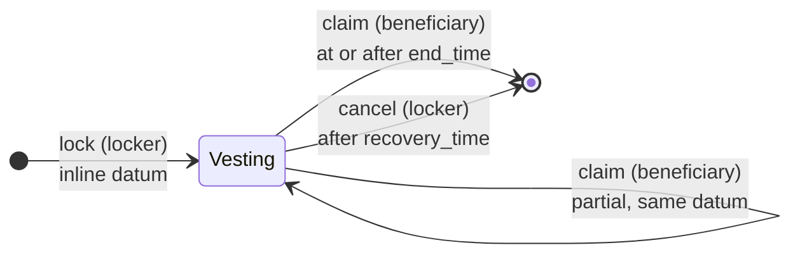

# Linear Vesting — Usage Guide

How to deploy and operate a **linear vesting** instance: a UTxO that releases a
bundle of ada or native tokens to a beneficiary between two times, with a
locker recovery after a grace period.

The entire state is a single **Vesting UTxO** at the vesting script address,
carrying an inline `VestingDatum`. The script is **not parameterized**: every
instance shares the same address and is distinguished by its UTxO and datum.
The datum is immutable, so a partial claim returns a continuation with the same
datum.

> **Source of truth.** Behavior, threat model, and invariants are specified in
> [`spec.md`](spec.md).
> This guide only covers day-to-day usage.

| Part | Where |
|---|---|
| On-chain validator | [`onchain/validators/linear_vesting.ak`](../../onchain/validators/linear_vesting.ak) (+ composable predicates in [`onchain/lib/vesting/`](../../onchain/lib/vesting/)) |
| MeshJS builders | [`offchain/meshjs/lib/src/vesting/`](../../offchain/meshjs/lib/src/vesting/) |
| Tx3 protocol + client | [`offchain/tx3/vesting/`](../../offchain/tx3/vesting/) (planned) |
| Compiled blueprint | [`onchain/plutus.json`](../../onchain/plutus.json) |

## Contents

- [Lifecycle](#lifecycle)
- [Roles](#roles)
- [Deploying the script](#deploying-the-script)
- [Off-chain usage: MeshJS builders](#off-chain-usage-meshjs-builders)
- [Script-credential authorization](#script-credential-authorization)
- [Off-chain usage: Tx3](#off-chain-usage-tx3)
- [Gotchas and safety notes](#gotchas-and-safety-notes)
- [Where to go next](#where-to-go-next)

## Lifecycle

A vesting instance is one UTxO. Claims keep it alive until the schedule is
exhausted; cancel ends it early, but only after the grace period.



- **lock** — the locker sends the bundle to the script with an inline datum.
  No script runs. The builder enforces
  `start_time < end_time < recovery_time` and funds the output with at least
  the totals listed in `vesting`.
- **claim** — the beneficiary withdraws the vested portion. Before `end_time`,
  the unvested remainder stays in a continuation with the same datum. At or
  after `end_time`, the whole bundle can be taken and no continuation is
  needed.
- **cancel** — after `recovery_time`, the locker recovers whatever remains.
  `recovery_time` is strictly after `end_time`, so cancel can never reach
  unvested funds.

## Roles

| Role | Credential | Powers |
|---|---|---|
| **Beneficiary** | `beneficiary` | Claim the vested portion from `start_time` |
| **Locker** | `locker` | Lock the bundle; cancel the remainder after `recovery_time` |

Both `beneficiary` and `locker` are pluggable `Credential`s: a key
(required signer) or a script (invoked via a withdraw-0 reward withdrawal).
A multisig, DAO, or smart wallet can fill either role — see
[`offchain/meshjs/lib/src/authorization.ts`](../../offchain/meshjs/lib/src/authorization.ts)
and [ARCHITECTURE.md](../ARCHITECTURE.md) §3.

## Deploying the script

The linear vesting validator has **no parameters**. Build the script and its
address once; every instance is a UTxO at that address.

```ts
import {
  vestingScript,
  vestingScriptAddress,
  validatorHash,
} from "@contracts-library/meshjs";

const script = vestingScript();
const address = vestingScriptAddress(networkId); // 0 = testnet, 1 = mainnet
```

Because the address is shared, a consumer must identify an instance by its UTxO
and datum, not by the address alone. There is no one-shot NFT or per-instance
script hash.

## Off-chain usage: MeshJS builders

The MeshJS builders are the reference developer-facing API. Install:

```sh
npm install @contracts-library/meshjs @meshsdk/core
```

### 1. Build the datum

```ts
import { ADA, type VestingDatum } from "@contracts-library/meshjs";

const datum: VestingDatum = {
  beneficiary: { kind: "key", hash: beneficiaryKeyHash },
  locker: { kind: "key", hash: lockerKeyHash },
  vesting: [{ policyId: "", assetName: "", total: 1_000n * ADA }],
  startTime: Date.UTC(2026, 0, 1),
  endTime: Date.UTC(2027, 0, 1),
  recoveryTime: Date.UTC(2027, 6, 1),
};
```

Times are POSIX **milliseconds**. `vesting` is the **original** bundle; ada is
the entry with an empty `policyId` and `assetName`. Every asset vests on the
same linear schedule.

### 2. Lock

```ts
await buildLockTx({
  txBuilder,                    // a MeshTxBuilder wired to your provider/wallet
  datum,
  utxos: lockerUtxos,
  changeAddress: lockerAddress,
  networkId,                    // 0 = testnet, 1 = mainnet
});
```

`buildLockTx` rejects `startTime >= endTime` or `endTime >= recoveryTime`, and
a malformed `vesting` bundle: entries must be strictly ascending by
`(policyId, assetName)` with no duplicates and no negative totals. Use
`sortVestingBundle` to order an unsorted bundle. It sends the bundle to the
script with an inline datum, flooring ada to `minUtxoLovelace` (default 1.5
ADA). Pass `lockAssets` to lock extra ada or tokens.

The on-chain code does **not** validate the lock. A malformed instance can
become unspendable, but it can never release more than its schedule allows
(spec §4.1 and §7).

### 3. Claim

```ts
await buildClaimTx({
  txBuilder,
  vestingUtxo,
  datum,
  now: Date.now(),              // POSIX ms used as the validity lower bound
  beneficiaryAddress,
  collateralUtxo,
  utxos: beneficiaryUtxos,
  network: "preprod",
});
```

The builder computes `requiredRemainder(datum, now)` and, when it is
non-empty, creates a continuation at the same address with the same datum. It
sets the validity range's lower bound to the enclosing slot of `now`. A full
claim (`now >= endTime`) creates no continuation. Pass `authorizer` when the
beneficiary is a script credential.

### 4. Cancel

```ts
await buildCancelTx({
  txBuilder,
  vestingUtxo,
  datum,
  now: datum.recoveryTime + 1,  // strictly after recoveryTime
  lockerAddress,
  collateralUtxo,
  utxos: lockerUtxos,
  network: "preprod",
});
```

The validator requires `now > recoveryTime` **strictly**. The builder only
rejects `now < recoveryTime`, so pass a time strictly after it — for example
`recoveryTime + 1`. `Cancel` produces no continuation.

## Script-credential authorization

To fill `beneficiary` or `locker` with a **script** credential, pass the
approving script through the `authorizer` option on every builder call; the
library verifies the hash matches the credential and wires the withdraw-0:

```ts
beneficiary: { kind: "script", hash: daoScriptHash },
authorizer: { scriptCbor: daoScriptCbor },            // redeemer defaults to unit
// or reference-based: authorizer: { reference: utxoCarryingTheScript, scriptHash: daoScriptHash }
```

## Off-chain usage: Tx3

The Tx3 implementation is **planned**; [`offchain/tx3/vesting/`](../../offchain/tx3/vesting/)
is a placeholder. The MeshJS builders above are the reference implementation
until it lands.

## Gotchas and safety notes

Protocol assumptions and the full threat model are in
[§7 of the spec](spec.md#7-threat-model--known-assumptions). What follows is the
operational part: what a builder must get right.

- **Lock is not validated on-chain.** The reference builder checks the schedule
  and the bundle (strictly ascending `(policyId, assetName)`, non-negative
  totals); a custom builder must do the same. A malformed lock can strand funds,
  never over-release.
- **Continuations are count-preserving.** For `k` inputs sharing a
  byte-identical datum, the transaction needs at least `k` continuations, each
  holding the full remainder. This stops double satisfaction and merging.
- **The script address is shared.** There is no NFT. Select an instance by its
  UTxO and datum, not by the address.
- **The MeshJS builder claims one instance per call.** The validator supports
  batching; compose additional inputs yourself if you need it.
- **Slot/ms rounding.** Builders convert the requested `now` to the enclosing
  slot for the validity lower bound. Keep that convention if you write your own
  builders.

## Where to go next

- [Spec](spec.md) — full behavior, threat model, invariants, and the formal
  must-accept/must-reject characterization.
- [On-chain code](../../onchain/validators/linear_vesting.ak) — reference
  validator; composable predicates in [`onchain/lib/vesting/`](../../onchain/lib/vesting/).
- [Devnet e2e test](../../offchain/meshjs/e2e/test/vesting.e2e.test.ts) —
  end-to-end usage of lock, claim and cancel, including the negative cases.
- [Architecture](../ARCHITECTURE.md) — composability conventions shared by
  every contract in the library.
