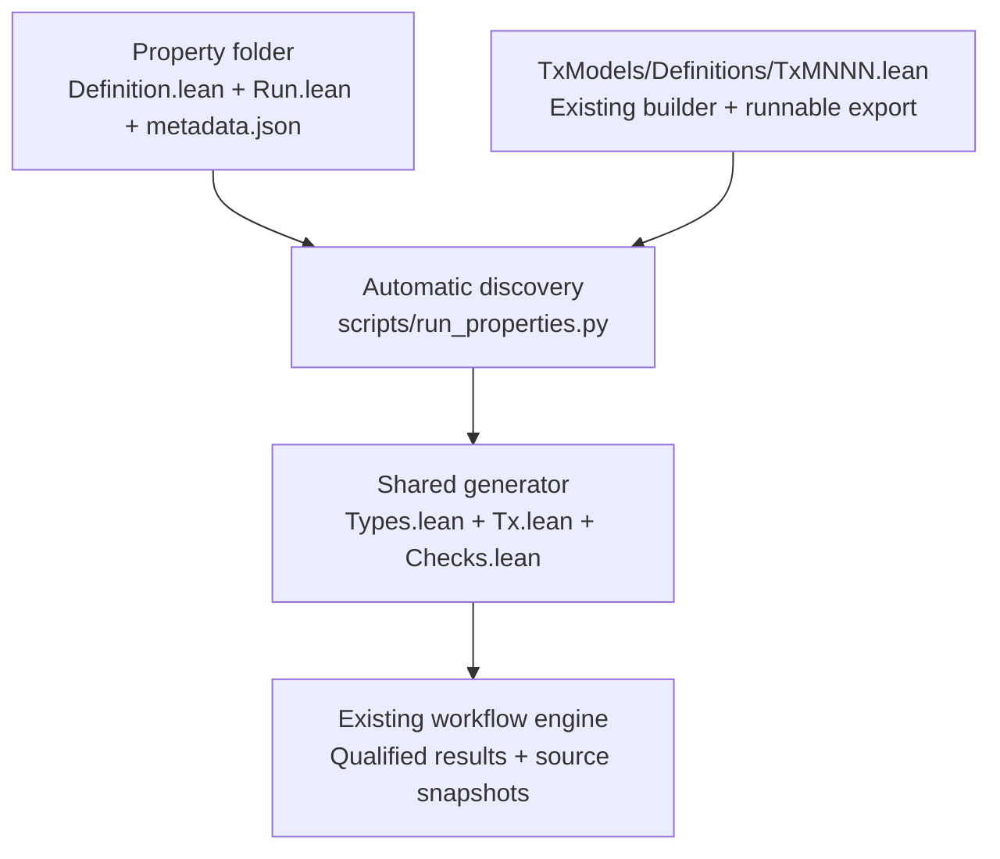

# Property-owned execution experiment

This local experiment tests issue #110's authoring flow. UP-012 owns its execution
instructions in [Run.lean](../../Formal/Properties/Universal/UP012/Run.lean).
The legacy CLI remains available for comparison.



From `formal/`:

```sh
python3 scripts/run_properties.py --list
python3 scripts/run_properties.py Workflow/Tests/UP012/Inputs/plutus.json --check UP-012 --timeout-ms 300000
```

The launcher discovers property `Run.lean` files and native models exporting
`def runnable : Runnable`. It builds those definitions and creates a bootstrap
under `output/discovery.*/`. The shared workflow owns actual verification, results,
timeouts, and source retention. Generated checks import the property's `Run.lean`
so the run instructions follow the saved source snapshots.

| Author action | File to edit |
| --- | --- |
| Write the rule and applicability predicate | The property's `Definition.lean` |
| Enable an existing compatible model | Only the `models` list in its `Run.lean` |
| Describe the property | Its `metadata.json` |
| Create a model | Its native model file, including one `runnable` export |

Authors select models in the property folder. The experimental command supplies
imports, goal templates, and registration. `Catalogue.lean` here contains generic
validation and lookup, without named property/model cases.

## Conventions and limits

Models retain their original Lean input types and context builders. The small
export identifies a builder and its input admission policy. The property owns
the goal arguments, expected theorem names, CEK bound, and applicability link.
Lean checks the resulting goal applications during verification.

The run format supplies one primary Valid goal, optional Valid applicability,
and a selected model builder as the final property argument. Model admission
supports the existing pinned vesting fixtures and
the existing conservative unparameterized V3 spending-schema matcher. This
selection change does not widen their transaction domains or prove new security
claims. Other property signatures or admission methods may need shared tooling
extensions. Supporting arbitrary Lean definitions is not a claim of this prototype.

Discovery uses conventional paths, namespaces, and a top-level
`runnable` export declaration. Lean type-checks the generated bootstrap; malformed
or ambiguous registrations fail. The prototype uses a source checkout, a Python
launcher, and scoped builds. The installed product CLI retains its existing path.
The bootstrap imports all discovered run files and exported models. A broken
unused export can therefore block startup. Selective compilation remains a
follow-up design question.

## Validation

```sh
python3 -I -B -m unittest discover -s tests -p test_property_discovery.py
lake exe workflow_declarative_tests
```

The Lean checks compare each generated statement and applicability job with the
existing UP-012 adapter, including model identity and fuel equivalence. Discovery
tests also add a model/property in an isolated temporary fixture without a central
registration file. Runtime evidence belongs under `output/`; do not infer proof
success from the unit tests alone.

The [local validation record](VALIDATION.md) records the one-file model-list
change, existing-goal comparisons, and real positive/negative/applicability controls.
