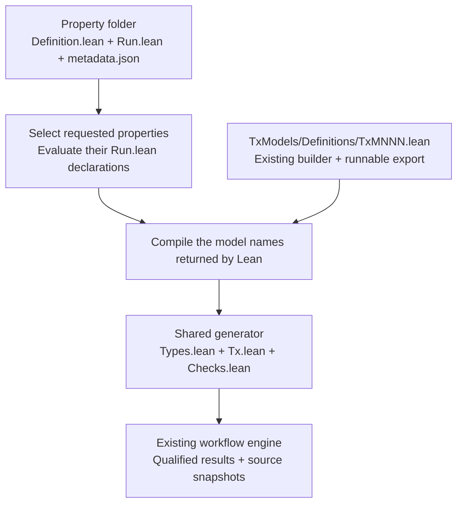

# Property-owned execution

The normal `plutus-upv run` command uses property-owned run instructions for
[UP-012](../../Formal/Properties/Universal/UP012/Run.lean) and
[UP-015](../../Formal/Properties/Universal/UP015/Run.lean). UP-001 retains its
existing implementation through a narrow compatibility bridge. The earlier
`universal` executable remains available for comparison.



From `formal/`:

```sh
python3 scripts/run_properties.py --list
./plutus-upv run Workflow/Tests/UP012/Inputs/plutus.json --check UP-012 --check UP-015 --timeout-ms 300000
```

The helper's `--list` shows property-owned combinations. The public command also
includes the legacy UP-001 purpose combinations.

The public launcher calls `scripts/run_properties.py` internally. Discovery reads
property identities, then compiles and evaluates only the requested `Run.lean`
files. Lean returns their actual model lists; the launcher does not parse those
lists from source text. It compiles only those model exports and creates a
bootstrap under `output/discovery.*/`. Generated checks import the property's
`Run.lean`, so its instructions follow the saved source snapshots.

Preparation has one deadline, at least 30 seconds and otherwise the requested
execution budget. A preparation timeout terminates the build process group. Each
actual validator/check combination keeps its existing separate execution budget.
The app retains preparation diagnostics in `discovery.json`; a startup failure
prints the separate preparation evidence path. Selection-file snapshots preserve
the exact bytes used for both planning and execution, including line endings.

| Author action | File to edit |
| --- | --- |
| Write the rule and applicability predicate | The property's `Definition.lean` |
| Enable an existing compatible model | Only the `models` list in its `Run.lean` |
| Describe the property | Its `metadata.json` |
| Create a model | Its native model file, including one `runnable` export |

Authors select models in the property folder. The shared command supplies
imports, goal templates, and registration. `Catalogue.lean` here contains generic
validation and lookup, without named property/model cases.

## Conventions and limits

Models retain their original Lean input types and context builders. The small
export identifies a builder and its input admission policy. The property owns
the goal arguments, expected theorem names, CEK bound, and applicability link.
Lean checks the resulting goal applications during verification.

The run format supplies one primary Valid goal, optional Valid applicability,
and a selected model builder as the final property argument. Model admission
supports the existing pinned vesting fixtures and
the existing conservative unparameterized V3 spending-schema matcher. This
selection change does not widen their transaction domains or prove new security
claims. Other property signatures or admission methods may need shared tooling
extensions. Supporting arbitrary Lean definitions is not a claim of this prototype.

Discovery uses conventional paths, namespaces, and a top-level
`runnable` export declaration. Lean type-checks the generated bootstrap; malformed
or ambiguous registrations fail. The checkout-backed CLI requires Python 3.9 or newer, Lean, and the documented
proof tools. The installer checks for Python and the Nix development shell includes
it. Managed standalone packaging remains separate work.

An explicitly selected property no longer compiles unrelated run files or model
exports. Invalid unused sources therefore do not block it. A selected source
that fails to compile still stops preparation with retained diagnostics. Default
selection includes all available properties, and ordinary explicit Lean imports
remain real dependencies. UP-001 keeps its existing fixed purpose dependencies
until its authoring path migrates.

## Validation

```sh
python3 -I -B -m unittest discover -s tests -p test_property_discovery.py
lake exe workflow_declarative_tests
python3 -I -B tests/test_public_declarative_cli.py
# Include bounded real validators and controls:
python3 -I -B tests/test_public_declarative_cli.py --proofs
```

The Lean checks compare each generated statement and applicability job with the
existing UP-012 adapter, including model identity and fuel equivalence. Discovery
tests also add a model/property in an isolated temporary fixture without a central
registration file. Runtime evidence belongs under `output/`; do not infer proof
success from the unit tests alone.

The [local validation record](VALIDATION.md) records the one-file model-list
change, existing-goal comparisons, and real positive/negative/applicability controls.
The [CLI integration record](INTEGRATION.md) covers selective compilation and
testing through the public command.
