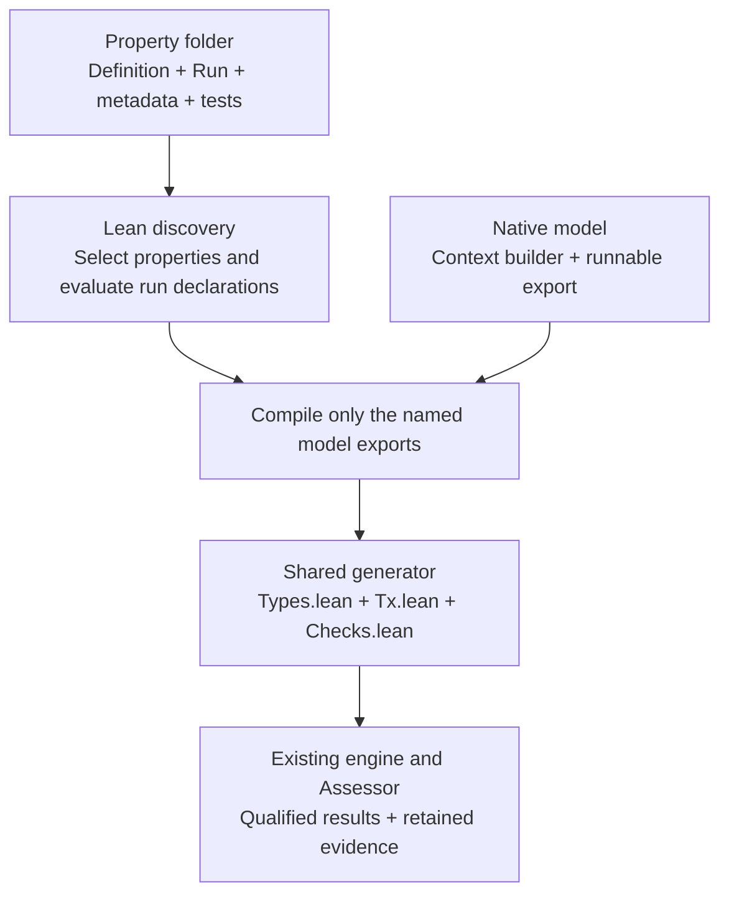

# Property-owned execution

The public `plutus-upv run` command discovers maintained run declarations for
[UP-000](../../Formal/Properties/Universal/UP000/Run.lean),
[UP-001](../../Formal/Properties/Universal/UP001/Run.lean),
[UP-012](../../Formal/Properties/Universal/UP012/Run.lean), and
[UP-015](../../Formal/Properties/Universal/UP015/Run.lean). Lean handles discovery,
selection, model preparation, and application launch. The earlier `universal`
executable is retired; internal legacy fixtures retain regression comparisons.

`Definition.lean` states the reusable property. Its sibling `Run.lean` supplies
execution instructions and one list of enabled models. Each list entry names a
model and records the reviewed limitations of that property/model pairing.
Models keep their existing context builders and export one `runnable` description
from `Formal/TxModels/Definitions/TxMNNN.lean`.



From `formal/`:

```sh
./plutus-upv run Workflow/Tests/UP012/Inputs/plutus.json --check UP-012 --check UP-015 --timeout-ms 300000
./plutus-upv run Workflow/Tests/UP012/Inputs/plutus.json --check UP-000
```

## Authoring contract

| Author action | File to edit |
| --- | --- |
| State the rule, applicability, and reusable helpers | The property's `Definition.lean` |
| Enable a compatible model and describe pairing limitations | The `models` entries in its `Run.lean` |
| Describe the property and supporting references | Its `metadata.json` |
| Maintain property controls | Its property-folder tests |
| Create a model | Its native model file, with context builder, metadata, and `runnable` export |

An enabled-model entry uses `ModelUse`: `id` selects the native model and
`limitations` retains the pairing's reviewed coverage and interpretation limits.
The shared catalogue derives registration from this list. It has no named
property or model cases, and descriptions alone cannot enable a check.

For example, changing one property's model list can enable an existing compatible
model. Authors still review whether that pairing makes sense and retain its
limitations; automatic registration does not infer security relevance.

A model's `Runnable` identifies its builder, input-admission policy, and optional
fixed purpose. The property owns its primary goal, optional applicability goal,
CEK bound, theorem names, and any target/model skip rule. Current model input
types, constructors, statements, applicability links, and bounds retain their
existing meanings. Lean checks the generated applications.

UP-001 uses its six native purpose models through this same route. Its property
run skips purposes declared by an admitted target. A skip generates no modules,
proof observations, or passing verdict.

UP-000 selects TxM-007/008, with one existential model-valid acceptance goal per
combination and no separate applicability goal. Its property-owned skip rule
restricts execution to the original vesting artifact, even though native model
admission also recognizes the second reviewed artifact. The skipped artifact
produces no proof verdict. The [UP-000 guide](../../Formal/Properties/Universal/UP000/README.md)
describes the 1,000,000-step bound, generated files, and remaining scope limits.

## Discovery and retained evidence

The launcher scans conventional property paths and metadata identities, then
applies the existing CLI selection rules. It compiles and evaluates only the
selected `Run.lean` declarations to obtain their actual model lists. It then
compiles those model exports and writes the application bootstrap in a fresh
`output/discovery.*/` directory. It does not parse model lists from Lean source.
Generated checks import the selected property's `Run.lean`, preserving those
instructions in the source evidence.

Preparation has one deadline, at least 30 seconds and otherwise the requested
execution budget. A timeout terminates the preparation process group. Each
validator/check combination retains its separate execution budget.
Selection-file snapshots preserve the exact bytes used during planning and
execution, including line endings. Successful runs retain `discovery.json`;
startup errors retain preparation indexes and logs and produce no proof verdict.

An explicitly selected property avoids unrelated run files and model exports.
Broken unselected sources therefore do not block it. A selected source that fails
to compile stops preparation with diagnostics. Default selection requests all
available properties. Explicit Lean imports remain real dependencies, so property
run declarations should avoid importing concrete model modules directly.

## Scope and validation

The current format supplies one primary Valid goal, an optional Valid
applicability goal, and a selected model builder as the final argument. Admission
supports the existing pinned vesting artifacts, conservative unparameterized V3
spending-schema matching, and raw unparameterized V3 contexts. Other property
signatures or admission methods may need a later shared extension.

The command uses a source checkout and the documented Lean/Z3 tools. It requires
no Python runtime or Nix. The separate legacy blueprint translator keeps its own
tooling requirements; managed standalone packaging remains separate work.

Focused checks from `formal/`:

```sh
lake exe workflow_property_discovery_tests
lake exe workflow_public_cli_tests
lake exe workflow_declarative_tests
lake exe workflow_declarative_up000_tests
lake exe workflow_declarative_up001_tests
lake exe workflow_declarative_up015_tests
lake exe workflow_up000_tests
./plutus-upv test
```

These suites cover discovery/selection behavior, model-list enablement, generated
goal and binding parity, reviewed limitation retention, and the existing workflow
controls. Unit success alone does not establish a property for a supplied target.
Fresh validation must record the actual source/dependency revisions and distinguish
expected negative controls from unexpected test failures.

[LEAN-VALIDATION.md](LEAN-VALIDATION.md) records the fresh Lean-only results.
[VALIDATION.md](VALIDATION.md) and [INTEGRATION.md](INTEGRATION.md) preserve earlier
prototype results. Their Python-era runs are historical evidence; they do not
validate the current Lean-only implementation or changed dependency combination.
